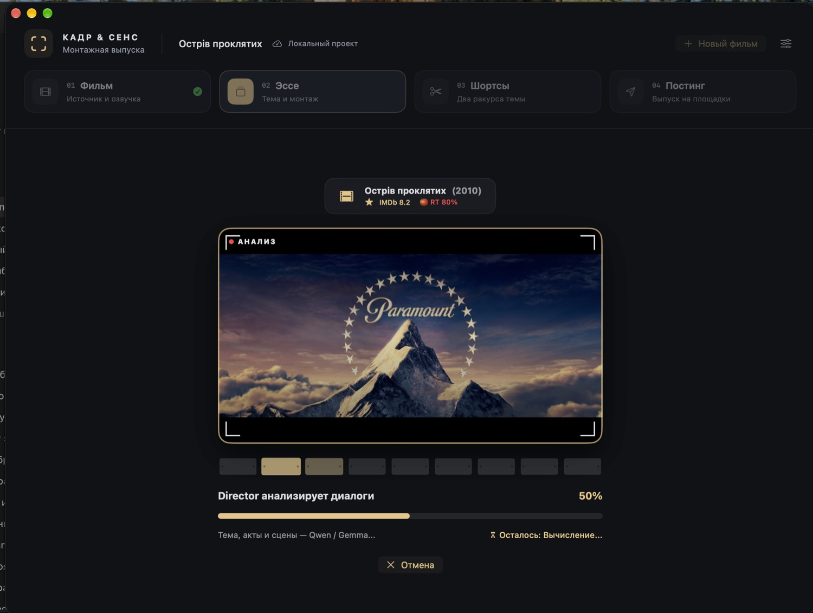

<div align="center">


# КАДР & СЕНС

### Кино становится мыслью.

Нативная macOS-студия, которая собирает киноэссе из смысла, диалогов и точных сцен — и доводит выпуск до публикации.

[Открыть презентацию](https://se1dhe.github.io/shortcuts/) · [Перейти к установке](#установка-и-запуск) · [Посмотреть архитектуру](docs/pipeline.md)

</div>

<p align="center">
  
</p>

---

## От фильма до релиза

| Шаг | Что происходит |
| --- | --- |
| **01 · Фильм** | Импорт локального видео, выбор аудиодорожки и подготовка субтитров или транскрипта. |
| **02 · Эссе** | Director выбирает тему, выстраивает пять драматургических актов и добирает сцены, если материала недостаточно. |
| **03 · Шортсы** | Из готового эссе собираются два вертикальных ролика с отдельными хуками, сценами и субтитрами. |
| **04 · Постинг** | Обложка, заголовок, описание, главы, хештеги и подготовка публикации. |

### Редактор остаётся за монтажным столом

- **Монтажная шкала:** сцены показаны самостоятельными клипами, между ними явно отмечены склейки. Исходные таймкоды и длительности помогают быстро увидеть порядок и ритм.
- **Сцены и акты:** проверьте ход аргумента и границы IN/OUT с предпросмотром; переставляйте фрагменты и при необходимости попросите модель исправить замечания редактора.
- **Своя сцена:** нажмите «+» в нужной точке последовательности, найдите реплику в транскрипте, уточните IN/OUT, просмотрите исходный фрагмент и вставьте его в начало, между сценами или в конец акта либо шортса.
- **Субтитры:** исправляйте текст в контексте видео и проверяйте экранное разбиение строк.
- **Шортсы:** меняйте порядок и длительность сцен, хук, заголовок, тезис, вопрос и субтитры независимо для каждого ролика.
- **Выпуск:** перегенерируйте обложку с другим кадром, не пересобирая само эссе.

Открытие проекта или шага не запускает анализ и рендер. Любая генерация, пересборка и отправка начинается отдельной командой.

## Установка и запуск

Приложение рассчитано на **macOS 15+** и **Apple Silicon**. Для локального Director нужен MLX и выбранная в настройках модель. WhisperKit используется для транскрипции, если рядом с фильмом нет субтитров. Обработка видео использует `ffmpeg` и `ffprobe`.

### Собрать из исходников

Нужны Xcode со Swift 6 и [XcodeGen](https://github.com/yonaskolb/XcodeGen).

```sh
git clone --branch RELEASE https://github.com/se1dhe/shortcuts.git
cd shortcuts
xcodegen generate
xcodebuild build \
  -project Shortcast.xcodeproj \
  -scheme Shortcast \
  -configuration Debug \
  -derivedDataPath .build \
  CODE_SIGNING_ALLOWED=NO
```

Успешная локальная сборка устанавливает одну актуальную копию приложения в `/Applications/КАДР & СЕНС.app` (если системная папка недоступна — в `~/Applications`). Для сборки без установки задайте `SHORTCAST_SKIP_INSTALL=1` перед запуском `xcodebuild`.

## Модели и внешние сервисы

- **Director** работает с локальной моделью, выбранной в настройках приложения. Генерация сцен требует доступной и прогретой модели.
- **WhisperKit** скачивает модель транскрипции только при необходимости.
- Для публикации нужны авторизация YouTube/TikTok и Telegram-бот с каналом. Подключение платформы не означает автоматическую отправку.
- Скорость и доступные функции зависят от выбранной модели, памяти устройства, настроек и API площадки.

Фильмы, транскрипты, проекты, модели, токены авторизации, экспорты и логи остаются локальными данными. В репозиторий попадают исходный код и обработанные демонстрационные изображения, но не пользовательские проекты или видео.

## Документация

- **[Интерактивная презентация и руководство](https://se1dhe.github.io/shortcuts/)** — обзор этапов, редакторов и выпуска.
- [Пайплайн и архитектура](docs/pipeline.md)
- [Проектирование киноэссе](docs/essay-design.md)
- [Материалы бренда](branding/)

Скриншоты на презентации показывают приложение. Редакторы эссе и шортса представлены специально подготовленными схематическими иллюстрациями, которые показывают монтажную шкалу, точки склейки и вставку сцен.

## Разработка

```sh
xcodegen generate
SHORTCAST_SKIP_INSTALL=1 xcodebuild build \
  -project Shortcast.xcodeproj \
  -scheme Shortcast \
  -configuration Debug \
  -derivedDataPath .build \
  CODE_SIGNING_ALLOWED=NO
```

Структура проекта:

- `Shortcast/` — приложение на SwiftUI и сервисы пайплайна.
- `ShortcastTests/` — проверки моделей, монтажа и редакторов.
- `scripts/browser-publisher/` — автоматизация браузерной публикации.
- `Vendor/gemma-4-swift-mlx/` — исходники vendored-зависимости Gemma/MLX.
- `docs/` — техническая документация.
- `site/` — GitHub Pages, ресурсы презентации и обработанные скриншоты.
- `branding/` и `channels_plan/` — материалы бренда и канала.

Презентация публикуется GitHub Actions из каталога `site/`: [se1dhe.github.io/shortcuts](https://se1dhe.github.io/shortcuts/).
