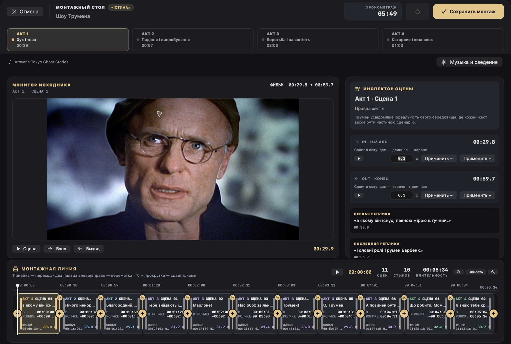
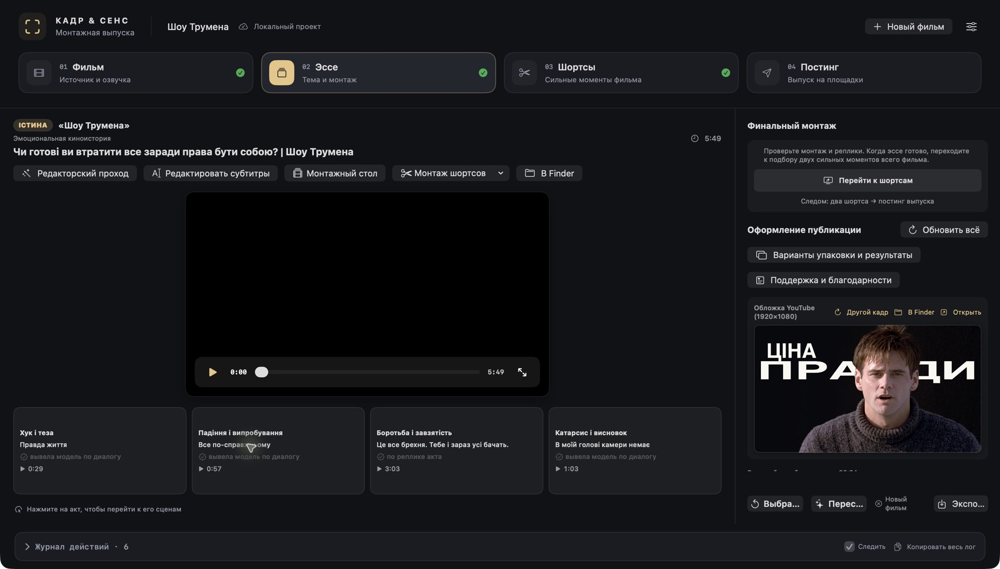
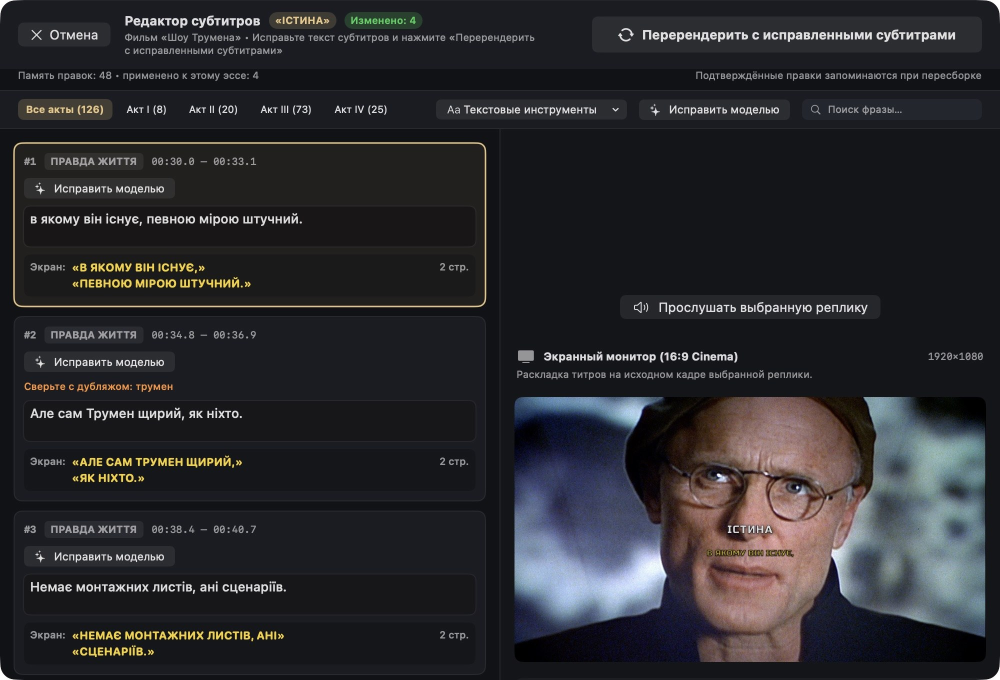
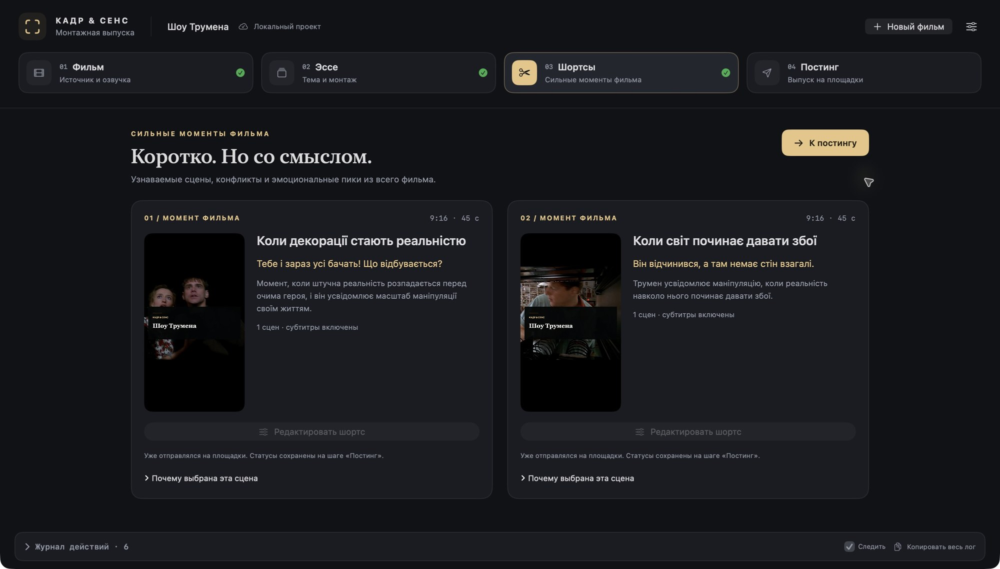
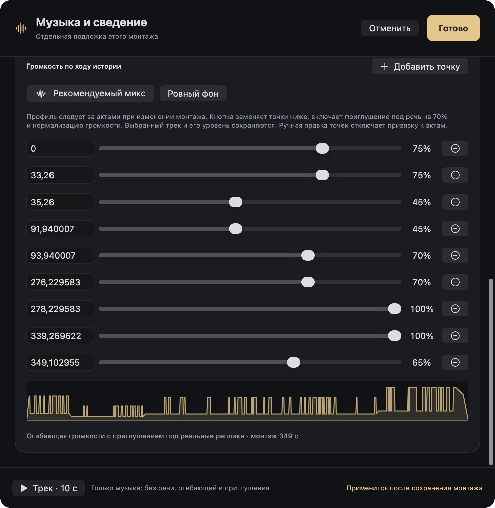

<div align="center">


# КАДР & СЕНС · Shortcast

### Від фільму до власної історії.

Нативна macOS-студія для кіноесе та Shorts: локальні AI-моделі, точний монтаж, українські субтитри й підготовка публікації в одному проєкті.

[Українська](https://se1dhe.github.io/shortcuts/) · [English](https://se1dhe.github.io/shortcuts/en.html) · [Русский](https://se1dhe.github.io/shortcuts/ru.html) · [Polski](https://se1dhe.github.io/shortcuts/pl.html) · [Deutsch](https://se1dhe.github.io/shortcuts/de.html) · [Встановлення](#встановлення) · [Архітектура](docs/pipeline.md) · [Зв’язатися з автором](https://t.me/se1dhe_l2)

Local AI video essay studio for Apple Silicon. Built with SwiftUI, MLX, WhisperKit and FFmpeg.
</div>



## Один проєкт — повний випуск

| Етап | Можливості |
| --- | --- |
| **Фільм** | Локальне відео або бібліотека контент-плану; вибір аудіодоріжки, підготовка MP4, локальне розпізнавання мовлення. |
| **Есе** | Вибір теми на основі реплік і сцен. Емоційна історія у чотирьох актах або аналітичне есе у п’яти. Перевірка плану перед рендером. |
| **Shorts** | Пошук сильних самостійних моментів у всьому фільмі. Два вертикальні ролики з окремим монтажем, текстом і субтитрами. |
| **Публікація** | Обкладинки, заголовки, описи, розділи, теги та закріплений коментар. Надсилання на налаштовані платформи з окремими статусами. |

### Монтаж залишається під вашим контролем

- **Монтажна лінія:** курсор відтворення, навігація тачпадом, точні IN/OUT, перестановка та ручне додавання сцен у потрібний стик.
- **Природні межі:** врахування завершення реплік і доступних пауз. Усі запропоновані фрагменти можна переглянути й підрізати вручну.
- **Українські субтитри:** редагування окремих фраз, AI-корекція з перевірками, пам’ять підтверджених виправлень і контроль мови.
- **Звук:** музична бібліотека з локальної папки, оновлення списку файлів, огинаючі гучності, приглушення під мовленням і нормалізація.
- **Оформлення:** кадри з фільму, перевірка головного персонажа, текст із глибиною за силуетом, варіанти обкладинок та історія експериментів.
- **Фінал:** необов’язкова подяка донатерам; ніки можна вводити окремо або списком.
- **Прозорий процес:** журнал поточних дій, попередження та помилки; перевірки результатів моделі перед застосуванням.

AI пропонує рішення, але не гарантує художньої якості чи відсутності помилок. Перевіряйте сцени, український текст, звук і метадані перед публікацією.

## Усередині студії

| Есе та акти | Субтитри |
| --- | --- |
|  |  |

| Два незалежні Shorts | Звуковий монтаж |
| --- | --- |
|  |  |

Це знімки реального застосунку, а не макети. Інтерфейс доступний українською, англійською й російською — мова перемикається в налаштуваннях без перезапуску. Мова інтерфейсу не змінює українські субтитри й контент випуску. На деяких екранах збережений проєкт показано після видалення готових відеофайлів.

## Встановлення

Потрібні **Mac з Apple Silicon**, **macOS 15+**, Xcode зі Swift 6 та [XcodeGen](https://github.com/yonaskolb/XcodeGen). Обсяг пам’яті й вільного диска залежить від вибраної моделі та вихідного відео. Потрібні `ffmpeg` і `ffprobe`; для торент-завантаження — `aria2c`.

```sh
brew install xcodegen ffmpeg aria2
git clone https://github.com/se1dhe/shortcuts.git
cd shortcuts
xcodegen generate
SHORTCAST_SKIP_INSTALL=1 xcodebuild build \
  -project Shortcast.xcodeproj \
  -scheme Shortcast \
  -configuration Debug \
  -derivedDataPath .build \
  CODE_SIGNING_ALLOWED=NO
open ".build/Build/Products/Debug/КАДР & СЕНС.app"
```

`SHORTCAST_SKIP_INSTALL=1` вимикає автоматичне встановлення під час збірки. Для встановлення зібраного застосунку в `/Applications` запустіть `./scripts/install-app.sh`. Згенерований Xcode-проєкт не зберігається в Git.

### Перший запуск

1. У налаштуваннях виберіть і завантажте сумісну локальну модель Director та модель WhisperKit.
2. Додайте фільм, виберіть українську аудіодоріжку та підготуйте транскрипт.
3. Оберіть формат і тему, перевірте план сцен, зберіть есе.
4. Перегляньте монтаж, субтитри, звук та оформлення. Після цього готуйте Shorts і публікацію.

Моделі, фільми, музика та авторизація сервісів не входять до репозиторію. Для музики використовуйте власні файли з відповідними правами. Завантажуйте та публікуйте лише матеріали, на використання яких маєте право; застосунок не гарантує монетизацію або відсутність претензій платформ.

## Локальна обробка й підключення

Director використовує MLX, а розпізнавання мовлення — WhisperKit на Mac. Для завантаження моделей, джерел відео та публікації потрібна мережа. Інтеграції YouTube і TikTok працюють через окремий браузерний publisher; Telegram потребує власних налаштувань. Статуси відправлення зберігаються окремо, щоб повторна спроба не дублювала вже підтверджену публікацію.

Підтримка завантажень із каталогу залежить від доступності зовнішнього сайту. Перетворення MKV на MP4 та очищення вихідного файлу виконуються в керованому процесі підготовки джерела. Медіафайли й робочі дані зберігаються локально.

Збережене есе можна відкрити й після видалення вихідного фільму. Перегляд плану та текстів не запускає повторну обробку; для відтворення джерела й нового рендеру потрібен відеофайл.

## Локалізація

Лендинг має п’ять статичних мовних версій. Спільний шаблон — `site/templates/index.html`, переклади — `site/locales/`. Після змін виконайте `python3 scripts/build-site-locales.py`. Скриншоти інтерфейсу розділені за мовами; для польської та німецької сторінок використовується англійський інтерфейс застосунку.

Каталог застосунку — `Shortcast/Resources/Localizable.xcstrings`; `L10n` обслуговує лише інтерфейс. Не локалізуйте ним транскрипти, промпти Director або тексти, що потрапляють у відео.

## Розробка

| Частина | Технології |
| --- | --- |
| Інтерфейс і стан | Swift 6, SwiftUI, Observation |
| Локальні моделі | MLX, vendored Gemma4Swift, WhisperKit |
| Відео й звук | AVFoundation, FFmpeg, ffprobe, Vision |
| Браузерна публікація | Node.js, Playwright Core |
| Лендинг | HTML, CSS, JavaScript, GitHub Pages |

```text
Shortcast/Models/              Моделі проєкту, випуску та монтажу
Shortcast/Services/            Медіа, транскрипція, бібліотека, AI
Shortcast/Services/Longform/   Есе, Shorts, оформлення й публікація
Shortcast/Views/              Нативний інтерфейс
ShortcastTests/               Перевірки логіки й медіапайплайна
scripts/browser-publisher/    Браузерні інтеграції
site/                        Статичний лендинг
```

### Перевірки

```sh
SHORTCAST_SKIP_INSTALL=1 xcodebuild test \
  -project Shortcast.xcodeproj -scheme Shortcast \
  -configuration Debug -derivedDataPath .build \
  CODE_SIGNING_ALLOWED=NO
node --test scripts/browser-publisher/test/*.test.js
git diff --check
```

Частина інтеграційних перевірок потребує локальних моделей, вихідних фільмів або авторизації; звичайна збірка не підтверджує якість конкретного згенерованого випуску.

Докладніше: [архітектура пайплайна](docs/pipeline.md) · [редакційна модель](docs/essay-design.md).

## Ліцензія та авторство

Код — [Apache 2.0](LICENSE). Сторонні компоненти мають власні ліцензії; див. [NOTICE](NOTICE). Кадри на знімках інтерфейсу належать правовласникам фільмів і показують роботу редактора. Фільми, моделі та музичні бібліотеки не розповсюджуються разом із кодом.

Автор: [se1dhe](https://github.com/se1dhe) · [Telegram](https://t.me/se1dhe_l2).
