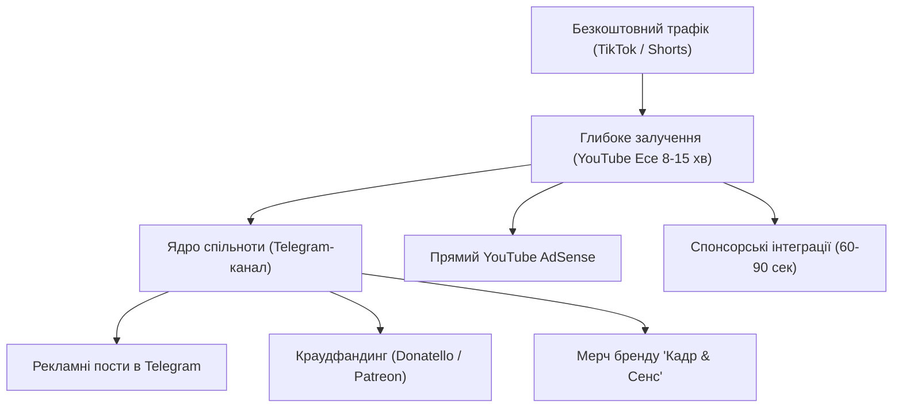

# СТРАТЕГІЯ МОНЕТИЗАЦІЇ ТА МЕДІАКІТ: «КАДР & СЕНС»

> **Позиціонування:** Преміальне україномовне ком'юніті інтелектуальних глядачів, поціновувачів естетики, культури та якісного сторітелінгу. Аудиторія платоспроможна (20–40 років), зацікавлена в технологіях, сервісах, книгах, стилі та мистецтві.

---

## 1. Джерела монетизації (Багаторівнева воронка)



---

## 2. Категорії цільових рекламодавців

1. **Онлайн-кінотеатри та Стрімінги:** Megogo, Sweet.tv, Takflix, Kyivstar TV (партнерські промокоди, ексклюзивні огляди прем'єр).
2. **Видавництва та Книжкові магазини:** КСД, Наш Формат, Vivat, Readeat, Yakaboo (книги про сценарії, біографії режисерів, нон-фікшн).
3. **Аудіо та Відеотехніка:** Навушники, акустика, проектори, монітори (Samsung, Marshall, Sony, JBL).
4. **Освітні платформи та Курси:** Prometheus, Projector, курси сценаристики та іноземних мов.
5. **VPN та Кібербезпека:** NordVPN, Surfshark, ExpressVPN (класичний спонсор кіноканалів).
6. **Кава, затишок та лайфстайл:** Крафтова кава, кіномерч, постери у рамах.

---

## 3. Тарифні пакети інтеграцій (Медиакит)

| Пакет | Формат | Що входить | Орієнтовна вартість |
|---|---|---|---|
| **Starter** | Telegram Sponsor | 1 рекламний пост у Telegram-каналі (1/24 або без видалення) + посилання | \$30 – \$60 |
| **Shorts Push** | Нативний Shorts/TikTok | Нативна згадка бренду у вертикальному відео + закріплений коментар | \$50 – \$100 |
| **Cinema Native (Mid-Roll)** | YouTube Інтеграція | Нативна інтеграція 60–90 секунд всередині відеоесе з логічною прив'язкою до теми фільму + посилання в закріпленому коментарі та описі | \$150 – \$350 |
| **General Sponsor** | Повний викуп випуску | Плашка на початку: «Випуск створено за підтримки [Бренд]» + Mid-roll 90с + пост у Telegram + 1 Shorts | \$250 – \$500 |

---

## 4. Скрипт холодного листа рекламодавцю (Email / TG Outreach)

```text
Тема: Колаборація з кінопроєктом «Кадр & Сенс» | Україномовна якісна аудиторія

Вітаю, [Ім'я представника бренду / Команда бренду]!

Мене звати [Ваше Ім'я], я автор україномовного кінопроєкту «Кадр & Сенс» (YouTube-есе, TikTok та Telegram-спільнота). Ми створюємо глибокі психологічні розбори культових фільмів, які збирають навколо себе свідому, дорослу та залучену аудиторію поціновувачів естетики.

Ми готуємо серію есе про [наприклад: фільми Крістофера Нолана / феномен українського дубляжу / культові драми], де контекст ідеально поєднується з філософією вашого продукту [Назва продукту].

Формат інтеграції:
- Нативна, органічна інтеграція на 60–90 секунд, знята у кінематографічній стилістиці (ніяких нудних "читань з листочка").
- Активні трекінг-посилання в описі, закріпленому коментарі та додатковий анонс у нашому Telegram-каналі.

Медіакит та статистика каналу: [Посилання на папку / PDF]

Будемо раді обговорити комфортний для вас формат та надіслати індивідуальні сценарії інтеграції.
З повагою,
Команда проєкту «Кадр & Сенс»
Контакт у Telegram: @[ваш_нік]
```

---

## 5. Краудфандинг та Донати (Donatello / Buy Me a Coffee)

- **Рівень 1 («Глядач у першому ряду» — 50 грн/міс):**
  - Доступ до закритого чату обговорень у Telegram.
  - Ім'я в титрах наприкінці кожного нового відеоесе.
- **Рівень 2 («Кінокритик» — 150 грн/міс):**
  - Участь у закритих щомісячних голосуваннях: вибір фільму для наступного розбору.
  - Ранній доступ до нових відео на 24 години раніше релізу.
- **Рівень 3 («Продюсер» — 500 грн/міс):**
  - Пряме замовлення 1 фільму на розбір раз на півроку.
  - Особиста подяка голосом автора у випуску.
