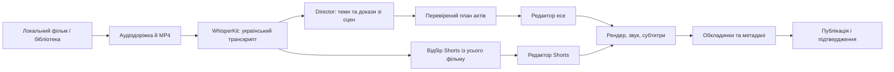

# Архітектура Shortcast

Shortcast — нативний застосунок macOS. `WorkspaceModel` координує стан проєкту; сервіси відокремлюють аналіз, підготовку джерела, монтаж, рендер і публікацію.

## Потік даних

## Межі відповідальності

- **Джерело:** `FilmLibrary`, `UAKinoAdapter`, `MediaExtractor` готують локальний матеріал. Очищення вихідника прив’язане до успішної підготовки MP4.
- **Транскрипція:** `TranscriptionService` розпізнає вибрану доріжку, зберігає походження результату та перевіряє мовні відхилення. Сторонні субтитри не повинні непомітно підміняти актуальний транскрипт.
- **Director:** сервіси в `Services/Longform` формують каталог сцен, теми, докази та план. Структурний і семантичний контроль відхиляє непридатні відповіді моделі; журнал пояснює повторні спроби.
- **Монтаж:** план зберігає джерельні таймкоди. Ручні правки меж, порядку та вставок доступні незалежно від AI-пропозицій.
- **Рендер:** AVFoundation і FFmpeg збирають відео, субтитри та звук. Готовий файл і стан редактора — різні артефакти; видалення відео не робить збережений план новим рендером.
- **Оформлення:** кадр, сегментація персонажа, композиція тексту та метадані готуються окремо від монтажу відео.
- **Публікація:** браузерний Node.js publisher обслуговує YouTube/TikTok, окрема інтеграція — Telegram. Підтвердження й помилки зберігаються за платформами.

Локальність моделей не означає відсутності мережі: завантаження моделей, відеоджерела та платформи публікації є зовнішніми залежностями. Реальна якість AI-результату потребує редакторського перегляду.
